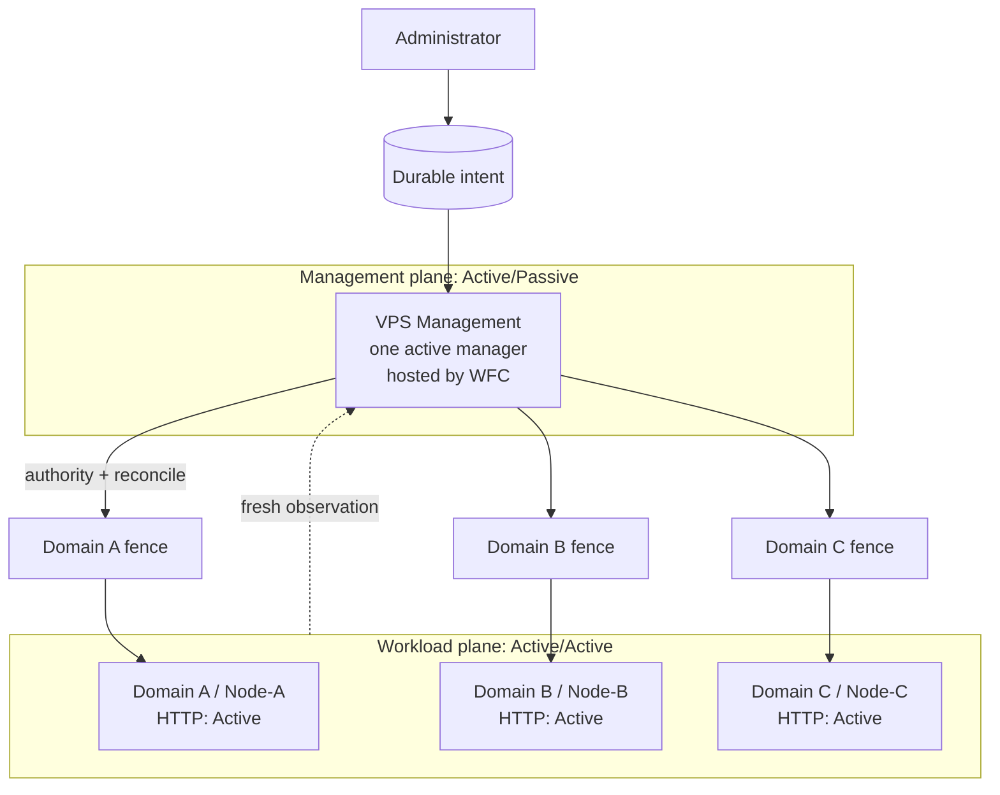
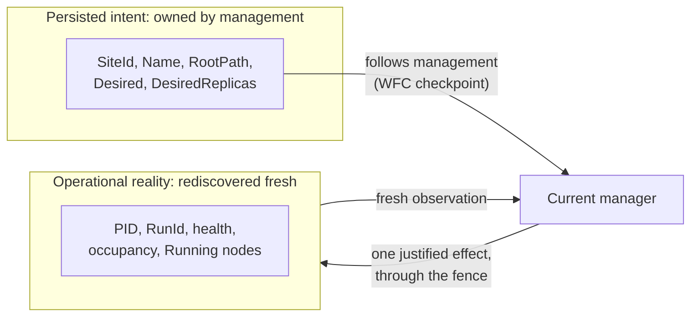

# Control Plane Experiment

> **Active/Active workloads do not require an Active/Active control plane.**

## Why this repository exists

This experiment grew out of a real production architecture discussion. The
production system is not the subject here.

During design review we had to reason about a question that sounds
counterintuitive: *can an Active/Passive management plane safely reconcile
Active/Active workloads?* Rather than argue it from theory, I distilled the
underlying distributed-systems problem into a small, public, falsifiable
experiment. The goal is not to recreate any production system. It is to
make the architectural reasoning independently inspectable.

The experiment asks narrow questions:

- What belongs in durable intent?
- What operational reality should be rediscovered rather than remembered?
- How is management authority established and transferred?
- How are stale managers prevented from causing new effects?
- What reconciliation machinery keeps Active/Active reality correct under a
  singleton manager?

Each answer was reached the same way: build the naive version, let it fail
or become ambiguous, then add the smallest mechanism that the evidence
earned. The failures are kept.

**What this is not:** a product, scheduler, orchestrator, VPS platform, or
Kubernetes alternative. Traffic management, storage availability, stronger
failure models and operational hardening are
[separate questions](#different-questions). The experiment stops once the
evidence answers the question it set out to explore.

## The result

One movable management authority, hosted by Windows Failover Clustering
(WFC), safely reconciled administrator-authored intent into HTTP
realizations serving simultaneously on three Windows execution domains.

The proof workload is one virtual HTTP site, such as `foobar.contoso.com`.
An administrator declares its name, content root, desired state and desired
replica count; the control plane keeps that many active instances running
across configured execution domains. Each healthy instance can serve the
site, which is what makes the workload Active/Active. How clients are spread
across instances is deliberately outside this experiment.



The site is declared with:

```powershell
New-VPSSite -Name foobar.contoso.com -RootPath \\server\path -DesiredReplicas 3
```

Each node serves `Host: foobar.contoso.com` from RootPath. The site is only
the proof object; the subject is intent, reality, identity, authority, effect
safety and reconciliation.

Demonstrated live ([Day 5.5](docs/day-05.5.md), [Day 5.6](docs/day-05.6.md)):

| Event | Healthy realizations started / stopped |
|---|---|
| Management moved, resource restarted, crashed and restarted locally, crashed again and failed over | **0 / 0** each time |
| ClusSvc killed under the manager (Day 5.5) | **0 / 0** |
| `DesiredReplicas` 3 → 2, then management moved | 0 / 1, then **0 / 0** (the new owner read the updated intent) |
| One replica killed | 1 / 0 (only that replica) |
| Site removed | stopped all, then deleted the intent |

Management moved; the workload did not. There is no DNS: each node was
addressed directly with an explicit `Host` header.

## How it got here

Each stage was earned by a failure, ambiguity, or missing proof in the one
before it.

| Day | Question | What it established |
|---|---|---|
| [1](docs/day-01.md) | What is the smallest honest reconciler? | Start returned ≠ Running. Convergence needs repeated matching observation. |
| [2](docs/day-02.md) | What must survive the manager? | A crash between Start and save made an orphan and a duplicate. Persist **intent**; **rediscover** reality from identity the workload exposes. |
| [3](docs/day-03.md) | Can authority move without moving the workload? | Yes, but a stale manager executed an earlier valid decision. Authority must be **fenced at the effect boundary**. |
| [4](docs/day-04.md) | Can one manager reconcile Active/Active replicas? | Occupancy, surplus and repair are rediscovered. One effect per pass; incarnation-verified Stop; Starting is not Degraded. |
| [5](docs/day-05.md) | What happens on a real HA substrate? | WFC gives placement and lifecycle but not fencing. Generation fences separate ownership from mutation authority, compose across nodes, and drive declarative service intent. |

Day 5 was first declared closed at 5.5. A review found that the test
harness, not WFC, still owned the manager's lifetime and the intent's
durability, so [Day 5.6](docs/day-05.6.md) reopened it. Hosting the manager
in WFC also exposed one real defect: a terminated manager could crash the
fence it was talking to.

## What persists, what is rediscovered



> Persist what the management plane knows because it owns it. Rediscover what
> it knows only because it observed it.

| Concern | Owner |
|---|---|
| Where management runs; process lifetime, restart, failover | WFC role and resource lifecycle |
| Durability and movement of intent | WFC registry checkpoint |
| Which manager incarnation may mutate | Authority generation, held per domain by the fence |
| Ordering of generation advance vs. Start/Stop | Execution-domain fence |
| Eligible domains | Configured topology (`name=host:port`), not cluster membership |
| Which effect to take next | Reconciliation, one effect per pass |
| DNS, content storage | Outside the boundary |

The checkpoint gives single-writer intent that follows the active role. It
is not a linearizable replicated store: a very recent write can be lost if
the role fails before WFC captures it.

The pairs the design keeps apart: durable intent and observed reality,
configured topology and observed occupancy, management placement and
workload placement, WFC lifecycle and mutation authority, generation and
workload lifetime, fencing and decision correctness.

Why healthy workloads survive a new manager:

> Advancing management authority invalidates stale mutations, not healthy
> reality created by an earlier valid authority.

The [Day 5 reflection](docs/day-05.md#alternatives-considered) also
discusses an alternative, generation-aware realization adoption, and why this
demonstrator chose to fence opaque mutations instead. The invariant is the
same for both: authority must be enforced at the last boundary before a stale
effect can become unsafe.

## Lessons

1. Actions initiate transitions; observations establish convergence.
2. Persist intent; rediscover reality through stable logical and incarnation
   identity.
3. Expose ambiguity before inventing policy.
4. A decision valid when made is not permanent permission to act.
5. Placement, mutation authority and effect fencing are distinct.
6. Fencing protects authority; it does not make the decision correct.
7. Reconciliation chooses the next justified effect from fresh observation,
   instead of persisting repair workflows.
8. Active/Passive management can reconcile Active/Active workload reality,
   and management movement need not cause workload movement.
9. Durable intent may need to outlive the resources whose absence it
   commands.

Corollary: when safe authority cannot be established, reduced management
availability is preferable to weakened safety. Method rule: stop when the
evidence is sufficient for the bounded claim.

## The bounded claim

> A movable Active/Passive management authority, hosted by Windows Failover
> Clustering and protected by per-execution-domain fencing generations,
> safely reconciled administrator-authored durable intent into Active/Active
> HTTP realizations across three Windows execution domains. WFC owned
> management placement, process lifetime and recovery, and carried the intent
> with the role. Management moves, restarts and failures did not cause healthy
> realizations to churn.

The three domains are VMs on one Hyper-V host, not independent physical
failure domains. The code does not encode three: `DesiredReplicas=N`
(`1 <= N <= configured count`) places on the first N configured domains, and
topology tests cover other sizes without a lab.

## Different questions

These are separate experiments, not unfinished features:

- **Traffic and discovery:** DNS, load balancing, TLS.
- **Content and data availability:** storage HA, content distribution.
- **Stronger failure models:** partitions, quorum loss, unreachable versus
  absent, independent physical failures.
- **Productization:** a general scheduler, production fence availability
  and authentication (the lab fence trusts the requester's claimed node
  name), semantic manager health, multi-writer intent, packaging, UI, Linux.

Details are in [Day 5: limitations](docs/day-05.md#limitations-and-different-questions).

**Where it stops.** WFC owns management placement, process lifetime and
recovery, and carries current intent. Generations and fences prevented the
stale effects reproduced here. Fresh observation and reconciliation let healthy realizations
outlive the managers that created them. That answers the question, so the
experiment stops ([why](docs/day-05.md#why-day-5-stops-here)).

## Why not Kubernetes?

Mature control planes already embody solutions to many of these problems.
Using one would solve the hosting problem while hiding the question under
investigation: which observed failure actually earns each mechanism? This is
neither an argument against Kubernetes nor an alternative to it.

## Reading path

You are not expected to read everything.

- **Five minutes:** this page.
- **Fifteen minutes:** [experiment framing](docs/experiment-framing.md), then
  the reflections for [Day 2](docs/day-02.md) (intent versus reality),
  [Day 3](docs/day-03.md) (stale authority), [Day 4](docs/day-04.md)
  (Active/Active reconciliation) and [Day 5](docs/day-05.md) (the real HA
  substrate, alternatives, and the stop).
- **Deep dive:** the per-experiment notebooks below, the source, the tests
  and live harnesses, and the pinned historical failures that still replay
  against their original commits. Read in order, the notebooks also work as a
  sequence of small distributed-systems lessons.

## Running it

With the .NET 10 SDK and PowerShell 7:

```powershell
dotnet build .\ControlPlaneExperiment.slnx
pwsh -NoLogo -NoProfile -File .\tests\all.ps1
```

`all.ps1` runs Days 1–4 and the local Day 5 checks, including pinned
historical failures, and needs no cluster. Manual commands and the live lab
harnesses are in [Running the experiment](docs/running.md).

## How this was built

The questions, priors, interpretation and stopping decisions are mine. AI
agents wrote most of the code, ran the harnesses and drafted much of the
documentation. That made small, falsifiable experiments, including
deliberately reproduced failures, cheap enough to iterate on quickly. It did
not decide what counted as evidence. The method is in
[experiment framing](docs/experiment-framing.md).

## Documents

- Day 1: [notebook](docs/day-01.md)
- Day 2: [2.1](docs/day-02.1.md) intent separate from manager lifetime ·
  [2.2](docs/day-02.2.md) start-before-save crash gap ·
  [2.3](docs/day-02.3.md) rediscovered identity ·
  [reflection](docs/day-02.md)
- Day 3: [3.1](docs/day-03.1.md) move authority, not workload ·
  [3.2](docs/day-03.2.md) stale Start ·
  [3.3](docs/day-03.3.md) authority at process creation ·
  [reflection](docs/day-03.md)
- Day 4: [4.1](docs/day-04.1.md) logical execution domains ·
  [4.2](docs/day-04.2.md) fenced, incarnation-verified Stop ·
  [4.3](docs/day-04.3.md) health loss and replacement ·
  [reflection](docs/day-04.md)
- Day 5: [5.1](docs/day-05.1.md) WFC placement ·
  [5.2](docs/day-05.2.md) stale Start across WFC movement ·
  [5.3](docs/day-05.3.md) generation fencing ·
  [5.4](docs/day-05.4.md) Active/Active across nodes ·
  [5.5](docs/day-05.5.md) declarative site intent ·
  [5.6](docs/day-05.6.md) WFC-hosted management and checkpointed intent ·
  [reflection and conclusion](docs/day-05.md)
- [Experiment framing](docs/experiment-framing.md) ·
  [Running the experiment](docs/running.md)

License: [MIT](LICENSE)
